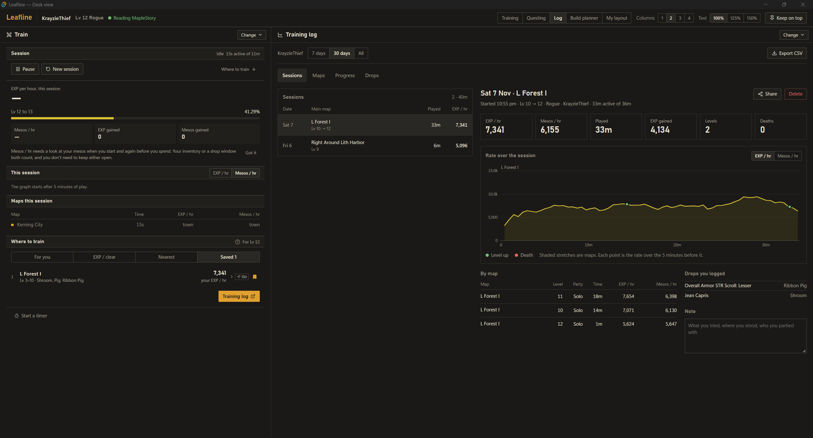
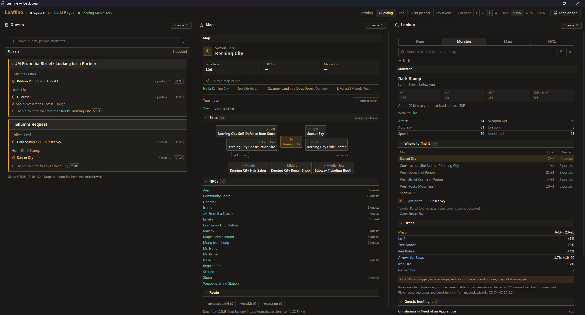
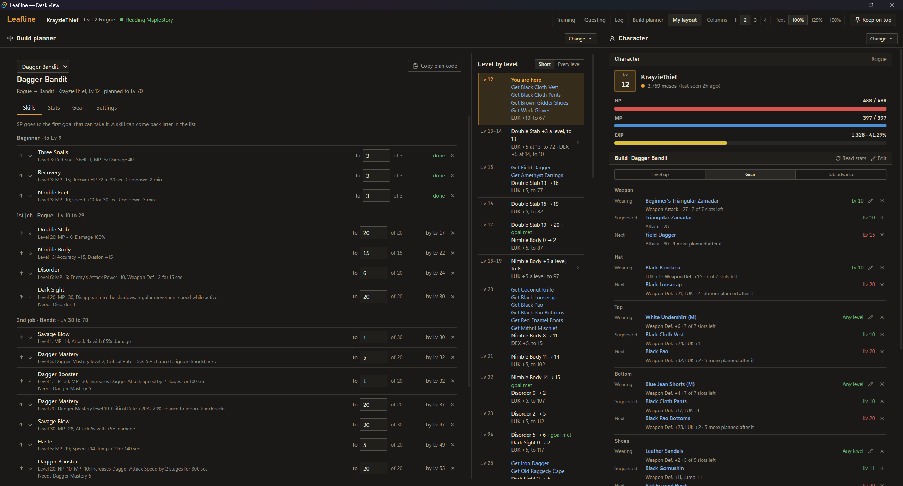

# Leafline

**A free, read-only companion for MapleStory Classic World that tells you what to do next.** It sits beside the game, follows your quests and gives directions one step at a time, checks items, keeps your build plan on track, and measures your EXP and meso rates, all from what the game already shows on screen.

[**Download the latest release**](https://github.com/Crazy3001/Leafline/releases/latest) · Windows 10 and 11 · [FAQ](#faq) · [Known limitations](#known-limitations) · [Changelog](CHANGELOG.md) · [Code signing policy](#code-signing-policy)

> [!WARNING]
> **Leafline is unofficial, and you use it at your own risk.** Nexon has not said whether read-only overlays are allowed. [More on the risk](#is-it-allowed-can-i-get-banned)

> [!NOTE]
> **Leafline is a work in progress.** This is an early version: some readings still slip, and plenty is still to come. It will keep growing and getting better with the community's help, so every bug report, misread picture and idea makes a difference. [How to help](#how-to-help)

<!-- Screenshots: Leafline-only pictures live in .github/screenshots. Pictures that show the game
     are GitHub attachments, never files in the repo. -->

## What it does

### Training
- **EXP and meso rates as you play:** EXP gained, EXP/hour, % per hour, time to level, mesos/hour, overall, per map and over the last five minutes, with a trend graph.
- **Readings are checked, not trusted:** EXP points and percent have to agree, a level-up has to show twice, and big meso jumps need several readings. Time in town, deaths and shop trades are kept out of the rates.
- **Sessions save themselves** as you go, with a line for each map, level, party size and job. The **training log** compares sessions and maps, and lists the drops you logged. Export it all to CSV.
- **Where to train:** the Train tab ranks maps near your level by EXP per kill, EXP per monster HP, the EXP/hour you measured there, or how close they are. Bookmark the spots you like.
- **Share card:** turn a session into a picture to post anywhere. Leafline draws it from scratch (no game art), leaves your character's name off unless you add it, and never posts anything itself.

### Items
- **Item check:** hover an item in game and press your hotkey. Leafline reads the tooltip and shows its stats with the base and bonus, its requirements, whether it's clean or scrolled (and how many scrolls failed), and whether your build can wear it.
- **Where to get it:** every monster players have seen drop it, each with the maps it lives on and a route there, plus the quests that give it.
- **Drop log:** log an item as a drop from a monster on your map, and send it on to MeowDB's community drop lists with one click if you like.
- **Your own notes** on any item, kept on your PC.

### Getting around
- **The map you're on:** its monsters, exits, NPCs, quests and drops, plus your rates there and your own notes.
- **Go here:** pick a map, NPC, monster or quest target, and a small bar shows the next step (which portal, taxi or return scroll) and moves on as you travel.
- **Lookup:** search every item, monster, map and NPC, with filters, and open any name you see in Leafline.

### Quests
- **Quest Helper, read live:** your tracked quests with their counters and rewards. Open one for its steps, directions to each monster, and who takes it in.
- **Quest search** across every quest by name, NPC, monster or region.

### Your character
- **Character tab:** level, job, HP, MP, EXP and mesos at a glance, with what your build plan says to do at this level.
- **Build planner:** a job and a list of goals in order ("this skill to 20, DEX to 25, the rest into LUK"), laid out level by level. It warns when a goal comes too late or SP would be lost at a job advancement. Ready-made plans for each 2nd job, each following one credited guide.
- **Follows your real character:** open your Stat or Skill window in game and the plan picks up from where you really are.
- **Gear:** what you're wearing, the best you can wear now, and the next step up, ranked by the stats your plan raises.
- **Job advancement checklist:** who to see and where, with a route, when an advancement comes up.

### Fits around the game
- **A small overlay** over the game, or shrink it to a **compact HUD**. Lock it so clicks pass through.
- **Pin** any tab into its own small window, including a Route pin for Go here.
- **Desk view:** every panel side by side in one big window, in tabs you can rename and rearrange (the training log and build planner have their own), remembering its size and tabs.
- **Hotkeys** that work while the game is in front, without sending the game any input. Setup tests each key with the game in front.
- **Countdown timers** for anything you want to keep time on.

## What it never does

Leafline only looks at the game window, the way OBS or Discord capture it, and reads the text with the OCR built into Windows.

- It never reads or changes the game's memory, files or network traffic.
- It never injects into the game or draws inside it. The overlay is its own window.
- It never presses keys or clicks for you. Nothing is automated: no botting, macros or auto-potions.
- It never saves pictures of your game unless you press **Save frame**, and never uploads screenshots, readings or records.
- It ships no Nexon assets: no sprites, icons or extracted game data. Item, monster, NPC and map pictures are downloaded from OSMS Data Explorer the first time each is shown and kept on your PC; turn them off in **Settings → Data**.

### Privacy

Nothing read from the game leaves your PC. Leafline only goes online to:

- download the community map, monster, quest and drop data (when you ask, then weekly),
- download a game picture from OSMS Data Explorer the first time it is shown, if game pictures are on (they start on), and
- ask GitHub for the latest version number at startup, if you turn the update check on (it starts off). That request carries Leafline's name and version and nothing else. A new version is downloaded only when you press **Download and install**: Leafline fetches the release's installer and its `SHA256SUMS.txt` from this repository, runs the installer only if its SHA-256 matches, and closes so it can install.

Your sessions, notes, drop log, builds and settings stay in `%APPDATA%\app.leafline.overlay`, with a daily backup of the last 7 days. **Settings → Data** opens the folder.

## Install

1. Download `Leafline_x.y.z_x64-setup.exe` from the [latest release](https://github.com/Crazy3001/Leafline/releases/latest). The `.msi` works too. Only download Leafline from this repository: copies elsewhere may have been changed.
2. Run it. The installer isn't code-signed yet, so Windows SmartScreen may say it "protected your PC". Choose **More info → Run anyway**.
3. Leafline opens a short **setup** the first time.

You need Windows 10 or 11 (64-bit) and the **English** MapleStory Classic World client. WebView2 comes with Windows 11; the installer adds it on Windows 10 if it's missing.

**Updating:** with the update check on, Settings → About says when a new version is out. **Download and install** downloads the installer, checks its SHA-256 against the release's checksum list, runs it and closes Leafline; or download it yourself from the release page and install it over the old one. Your records stay either way.
**Uninstalling:** from Windows' *Installed apps*. Your records stay in the folder above, so delete that too if you want them gone.

## Getting started

Setup walks you through five short steps:

1. **Welcome:** turn live reading and the update check on or off.
2. **Hotkeys:** nothing is bound until you choose. It suggests `Win+F8` to read an item, `Win+F9` to show or hide the overlay and `Win+F7` to lock it, then asks you to press each one with the game in front to be sure it gets through.
3. **Game settings** that help Leafline read (below).
4. **How to show Leafline:** the overlay, the desk view, or both.
5. **Map data:** the one-time download of community data.

Then play. Leafline finds the game window by itself and starts reading. Closing a window hides it; Leafline keeps running in the tray until you choose **Quit**. Run setup again any time from **Settings → About**.

### Recommended game settings

| Setting | Why |
|---|---|
| **UI Size: Ideal Ratio** (Graphics options) | Tested most. Other UI sizes can misread for now. |
| **Windows HDR off**, then restart the game | HDR washes out captures. Leafline warns you if it's on. |
| **Windowed or Full Screen** | Both work. The game's Full Screen isn't exclusive, so the overlay still shows. |
| **English client** | Other languages aren't read yet. |

### Hotkey tips

Add **Win** to every hotkey. While the game is in front it keeps plain keys to itself, even ones it doesn't use (Pause, the numpad), but Win combinations get through, and the game can't bind Win. Avoid **Ctrl** and **Alt**: the game sees them while you hold them, so a hotkey with Ctrl can make your character attack. F12 can't be used; Windows keeps it.

## FAQ

### Is it allowed? Can I get banned?
Nobody knows for sure. Nexon hasn't said either way: support replies to similar questions quote the rule against unauthorised third-party software and say they can't comment on specific programs. A support ticket asking whether read-only overlays are allowed has had no answer yet. Leafline is built to stay on the safe side of every line we know of (see [What it never does](#what-it-never-does)), but passive doesn't mean approved. Penalties carry across Nexon games on one account, so think about using a separate account.

### Is it free?
Yes, and it stays free: no ads, no paid features, no account. The code is open source under the MIT licence.

### Why does Windows warn me when I install it?
The installer isn't code-signed yet, and SmartScreen warns about any new unsigned program. Code signing is planned. Until then, **More info → Run anyway**, or build it yourself from this code.

### Was it made with AI?
Yes. Leafline is built with Claude, Anthropic's AI coding assistant. I decide what it does, test it in game and send back what goes wrong; Claude writes the code. All of it is open source here, so anyone can read exactly what it does and how.

### Does it work on Mac or Linux?
Not yet. Windows only for now; a macOS version is planned.

### Does it need the game's files, or log in to anything?
No. It only looks at the game window. It has no login and never asks for your Nexon account.

### Why doesn't it show market prices?
Leafline won't use a price site's data without its permission, and it won't read chat or player shops as you play. Price data may come later if a site agrees. For now each item shows its NPC sell price from the data.

### Something reads wrong. What should I check?
Most misreads come from game settings: **UI Size: Ideal Ratio**, **HDR off** (restart the game after), and the English client. Bright, busy maps such as Henesys can make the Quest Helper hard to read, since its text is black on a see-through panel. Item tooltips are the same: the box is drawn over whatever is behind it, so move your inventory or equipment window to a quiet part of the screen and close any windows (chat, other panels) behind where the tooltip appears, then hover the item and press the hotkey again. Leafline prefers showing nothing over showing a wrong number, so a blank usually means it wasn't sure.

### How do I report a bug?
[Open an issue](https://github.com/Crazy3001/Leafline/issues). **Settings → Feedback → Bug report details → Copy** copies what Leafline knows about its own state, with no character names, chat or file paths. A picture helps too: **Save frame** on the overlay saves the last picture Leafline read. It shows your game, so only post it if you're happy to share it.

### Where's the data from?
Map, monster, NPC, quest, skill and item facts come from OSMS Data Explorer. Quest turn-ins and monster drops come from Leafline's own data files: turn-ins as the game itself records them, drops from the game's item text, StrategyWiki and players' reports. See [Data and credits](#data-and-credits). The drop list covers etc items without rates, so it says who drops what, not how often.

## How to help

Leafline is built in the open, and what players send in decides what gets fixed and added next.

- **Report what reads wrong.** [Open a bug report](https://github.com/Crazy3001/Leafline/issues/new?template=bug_report.yml) with **Settings → Feedback → Bug report details → Copy**. A saved frame of the misread (**Save frame**) is the single most useful thing you can send, since every reading fix so far started from one.
- **Suggest what it should do.** [Share an idea](https://github.com/Crazy3001/Leafline/issues/new?template=idea.yml): something you look up mid-game, or a number you wish you could see.
- **Send in the drops you see.** [Share them as an idea](https://github.com/Crazy3001/Leafline/issues/new?template=idea.yml) ("Ribbon Pig: Leather"). Leafline's drop list is partly built from players' reports, so every drop you send shows up for every player.
- **Tell other players about it,** and star the repository if it helps you. That also helps Leafline qualify for free code signing, which gets rid of the Windows warning.
- **Write code.** [DEVELOPMENT.md](DEVELOPMENT.md) explains how to build it and how it works inside.

## Known limitations

This is an early release, and these are the rough edges known so far. Please [report](https://github.com/Crazy3001/Leafline/issues) anything else that doesn't work.

- **Tested mostly at 2560×1440 and 1920×1080**, at Ideal Ratio. Other resolutions and UI sizes are less tested.
- **The Quest Helper** reads well over dark maps and poorly over bright, busy ones.
- **Mesos/hour** needs a look at your mesos now and then (inventory open, or a shop). It says how much of the session it covers.
- **Shop, storage and trade windows** are recognised by their buttons, which hasn't been checked much on real frames.
- **The party count** hasn't been checked on a real party yet.
- **Ready-made build plans** follow one written guide each and credit it in the app. Nobody has played them through yet, so treat them as a starting point.
- **The planner counts points.** It doesn't work out damage, accuracy or HP, because those are unsettled for Classic.
- **A jump of several levels** between two readings adds no EXP, since the levels in between were never measured.
- **Windows HDR** has to be off for reliable readings.
- **Windows only**, English client only.

## Data and credits

Leafline ships no game data. It downloads community data on your PC when you ask, keeps it in a local cache, and credits it in the app:

- Map, monster, NPC, quest, skill and equipment data: [OSMS Data Explorer](https://osmsdataexplorer.com), CC BY 4.0.
- Monster drops: built for Leafline from the game's item text, [StrategyWiki](https://strategywiki.org/wiki/MapleStory/Drops_(Victoria_Island)) contributors (CC BY-SA 4.0) and players' reports.
- Taxi routes and return scrolls: [mapleclassic.wiki](https://mapleclassic.wiki) contributors, CC BY-NC-SA 4.0.

Game content belongs to Nexon. Leafline is unofficial and not affiliated with or endorsed by Nexon.

## Code signing policy

Releases aren't code-signed yet. Free signing through [SignPath Foundation](https://signpath.org) is planned once Leafline qualifies for it.

Until then, a download is genuine if it comes from this repository's [Releases](https://github.com/Crazy3001/Leafline/releases) page. Every release is built from this repository's source by its [release workflow](.github/workflows/release.yml) on GitHub Actions, not on anyone's PC.

- Committers and reviewers: [Crazy3001](https://github.com/Crazy3001)
- Release approvers: [Crazy3001](https://github.com/Crazy3001)

**Privacy policy:** this program will not transfer any information to other networked systems unless specifically requested by the user or the person installing or operating it. In detail: it downloads the community data from [OSMS Data Explorer](https://osmsdataexplorer.com) and [mapleclassic.wiki](https://mapleclassic.wiki), and Leafline's own data files from GitHub, when you ask (then checks them for changes once a day), asks GitHub for the latest version number only if you turn the update check on, and downloads a new version's installer from this repository only when you press Download and install. Nothing read from the game, and none of your records, is ever sent anywhere. See [Privacy](#privacy).

## Building from source

See [DEVELOPMENT.md](DEVELOPMENT.md) for building, testing the readers, and how Leafline works inside.

## Licence

Leafline's code is under the [MIT licence](LICENSE). It doesn't cover game content or the downloaded data above, which keep their own terms.
